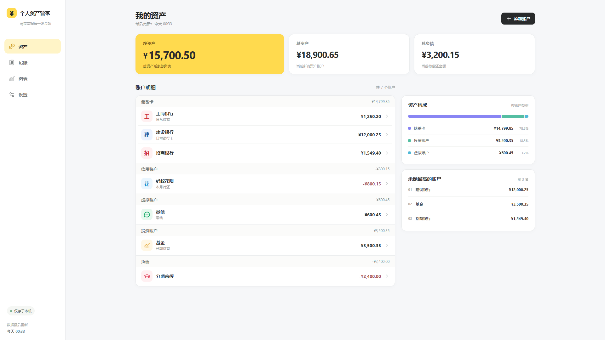
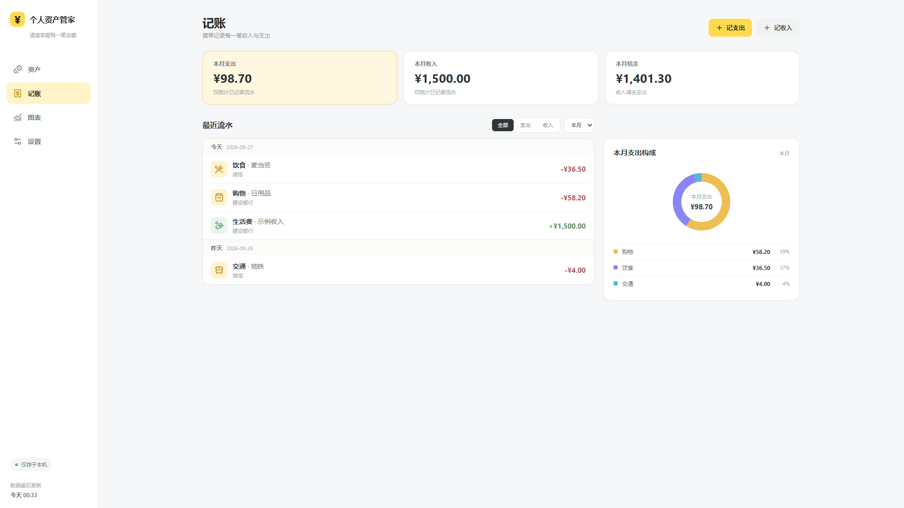
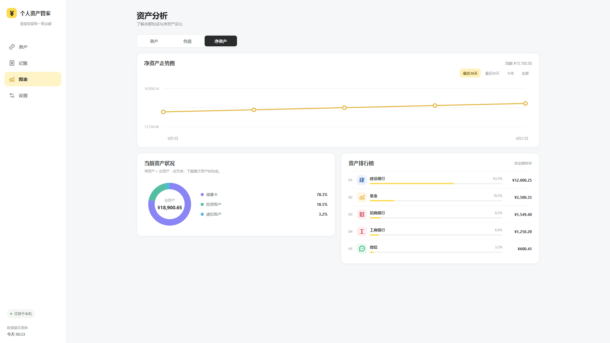

<div align="center">
  
  <h1>Cash · 个人资产管家</h1>
  <p><strong>看清资产，记录日常。</strong></p>
  <p>一个留在你电脑里的个人财务空间。</p>
  <p>
    
    
    
    
  </p>
  <p><a href="https://github.com/Xiaotian69/cash/releases/tag/v1.0.0">下载 v1.0</a> · <a href="docs/GUIDE.md">使用指南</a> · <a href="docs/ROADMAP.md">未来规划</a> · <a href="https://github.com/Xiaotian69/cash/issues">反馈建议</a></p>
</div>



> 展示图使用虚构账户与金额。首次启动为空白状态，不包含任何个人财务数据。

## 从分散的余额，到清楚的全貌

银行卡、零钱、投资和待还款，往往分散在不同地方。Cash 把它们放进一个安静、清晰的桌面界面：今天有多少资产，承担多少负债，净资产又如何变化，一眼就能看见。

从维护账户余额开始，到随手记下一笔收支，Cash 希望让了解自己的财务状态成为一件轻松的小事。无需注册，核心功能在本机运行，记录由你掌握。

## 1.0，让日常财务有条理

| 能力 | 为你解决什么 |
| --- | --- |
| **资产总览** | 汇总总资产、总负债与净资产，支持现金、储蓄卡、信用、虚拟、投资、负债及自定义账户。 |
| **随手记账** | 记录收入和支出，填写分类、日期、备注，按月份查看收支与结余。 |
| **余额联动** | 记账时可同步更新账户余额，也可关闭联动补记历史；修改已联动流水会重新计算影响。 |
| **趋势图表** | 用每日快照观察资产变化，查看资产构成与账户排行。 |
| **本地备份** | 导出 JSON，随时恢复账户、流水、历史快照和设置。 |
| **Windows 桌面体验** | 独立窗口、中文界面、简洁导航，无需常驻浏览器。 |

<table>
  <tr>
    <td width="50%"><br /><strong>记录每一笔日常</strong></td>
    <td width="50%"><br /><strong>看见长期的变化</strong></td>
  </tr>
</table>

## 三步开始

1. 在 [Releases](https://github.com/Xiaotian69/cash/releases/tag/v1.0.0) 下载 Windows x64 安装包并安装。
2. 添加常用账户，填入当前余额；信用和负债账户填写正数欠款，界面会以负号显示。
3. 开始记录收支，并在「设置」定期导出备份。

Windows 运行需要 WebView2 Runtime。首次安装或补装运行组件可能需要网络；应用日常记账和资产管理可离线使用。

## 数据属于你

- **本地保存**：账户、流水和快照存放在本机 WebView2 的 IndexedDB 中。
- **无需账号**：v1.0 没有登录、云同步、银行连接或 AI 服务调用。
- **空白起步**：安装后不会自动写入演示账户。
- **自主备份**：JSON 备份是明文文件，请自行妥善保管；导入会覆盖当前数据。

本地存储不等于加密保险箱。Cash v1.0 不提供数据库加密；建议使用系统账户保护电脑，并保留独立备份。更详细的数据位置、迁移和卸载说明见 [使用指南](docs/GUIDE.md)。

## 下一步，从记录走向理解

**v1.0 是起点。** 我们希望 Cash 逐步成为更完整的个人财务工具：更顺手的记账、更清晰的预算与报表，以及可选的 AI 辅助。

- **记账进阶**：探索转账、退款、周期账单、自定义分类和账单导入。
- **财务视角**：探索预算、储蓄目标、月度复盘和现金流分析。
- **AI 接口**：探索用户自选服务商、配置接口，辅助分类、自然语言记账和财务摘要。

以上均为规划，**尚未在 v1.0 实现，也不代表确定的发布时间**。未来若引入 AI，计划以明确授权和最少必要数据为前提，不默认上传完整账本。查看 [路线图](docs/ROADMAP.md)。

## 本地开发

前端使用 React + TypeScript + Vite，桌面外壳使用 Tauri 2，数据层使用 IndexedDB。

```bash
git clone https://github.com/Xiaotian69/cash.git
cd cash
npm ci
npm run dev
```

建议使用 Node.js 22.12+。Windows 桌面构建还需要 Rust MSVC 工具链、Visual Studio C++ Build Tools 和 WebView2：

```bash
npm run tauri dev
npm run tauri build
```

```bash
npm test
npm run lint
npm run build
```

浏览器验收、桌面布局检查和原生持久化验证见 [开发与使用指南](docs/GUIDE.md)。

## 当前边界

账户余额由用户维护；投资账户不接入实时行情。货币设置只改变显示符号，不进行汇率换算。历史趋势来自每日资产快照，不代表完整的银行账单。当前发布包面向 Windows x64，其他平台尚未验证。

---

<div align="center"><sub>Cash 1.0 · 少一点财务碎片，多一点生活秩序。</sub></div>
